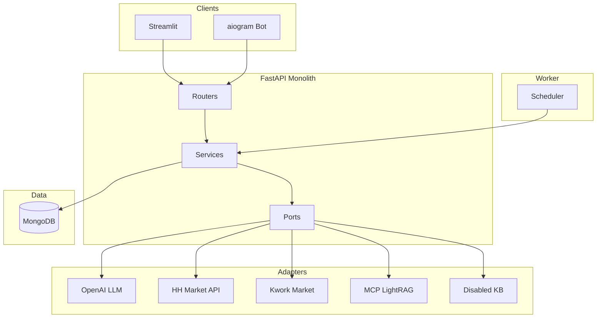

# Personal AI Coach — план реализации

Исходное описание: [DescrShot.md](./DescrShot.md)

---

## 0. Журнал работы (версионный)

| Дата/время (UTC+8) | Промпт / действие | Сделано |
|---|---|---|
| 2026-10-09 | Создать план в todoList: исследование GitHub, LightRAG MCP on/off, карьерные цели (найм/фриланс/подработка) | Зафиксированы решения, аналоги, архитектура, backlog, DoD |
| 2026-10-09 | Уточнения: single-user MVP; LightRAG только через MCP из приложения; hh.ru API + Kwork; aiogram 3; несколько треков, один активный | Отражено в разделах 1–8 |
| 2026-10-09 ~11:22 | VPS `193.168.196.12`, домен `aicareercoach.alexklyvibe.ru`; снести старый деплой [AI-PredictiveSalesAnalytics](https://github.com/alexklychnikov-ui/AI-PredictiveSalesAnalytics) безвозвратно | Раздел 6.0 + этап 8 + DoD |
| 2026-10-09 ~11:39 | Деплой через SSH Host из `~/.ssh/config`: `AIcareerСoach` → `193.168.196.12`, key `~/.ssh/alexklyvibe` | §6.0 SSH |
| 2026-10-09 ~11:57 | Заложить `env.example` + локальный `.env` (секреты заполняет владелец) + `.gitignore` | Корень репо |
| 2026-10-11 ~12:05 | Приступить к реализации плана | Scaffold MVP: FastAPI/Mongo/Streamlit/bot/worker/adapters/tests/compose |
| 2026-10-11 ~12:22 | Docker Desktop включён — поднять стек | `docker compose up -d --build`; health ok, Streamlit 200 |
| 2026-10-11 ~12:40 | RU заголовок + деплой VPS | UI «Персональный ИИ-коуч»; sales-analytics снесён; https://aicareercoach.alexklyvibe.ru/ 200 |
| 2026-10-11 ~12:51 | Онбординг: список треков + upsert без дублей + seed из LightRAG | Профиль/трек засеяны на VPS (first_freelance_order) |
| 2026-10-11 ~14:25 | Smoke без HH + Telegram bot на VPS | API smoke PASS; bot @alexvibeaipersonalcoach_bot polling; hh=0 |
| 2026-10-11 ~17:36 | Аудит todoList: что закрыто по MVP | Код MVP (этапы 0–7 + деплой) — done; hh live ждёт модерацию; этап 8 частично; этап 9 / DoD сдачи — open |
| 2026-10-11 ~17:44 | userManual по блокам дашборда | `Docs/userManual.md`: онбординг/план/рынок/коучинг/интервью/статус + TG + сценарии |
| 2026-10-11 ~17:48 | Публичный GitHub | init + push alexklychnikov-ui/PersonalAICoach (без .env) |

---

## 1. Цель продукта и критерии успеха

**Продукт:** личный AI-коуч для карьеры — онбординг, план 1/3/5 лет, skill-gap, рынок (hh + Kwork), weekly coaching, mock interview, Telegram check-in, опциональный контекст из LightRAG.

**Пользователь MVP:** один владелец (single-user), без регистрации и multi-tenant.

**Критерии успеха MVP:**

- Пройден онбординг → сохранён профиль и **один активный карьерный трек**.
- AI выдаёт **структурированный** карьерный план (этапы, навыки, ресурсы, чек-лист задач) с валидацией схемы.
- Есть skill-gap относительно выбранной вакансии (hh) или проекта (Kwork) + ручной импорт текста.
- Weekly coaching в Streamlit и/или Telegram; прогресс по задачам и check-in.
- Mock interview (текст) с feedback.
- `KNOWLEDGE_BASE_ENABLED=false` — приложение работает; `true` + живой MCP — ответы могут обогащаться контекстом (`knowledge_context_used`).
- Репозиторий: README, `.env.example`, Docker Compose (dev), скриншоты/скринкасты под сдачу + черновик ТЗ (.docx).
- Публичное демо на **https://aicareercoach.alexklyvibe.ru/** (VPS `193.168.196.12`).

---

## 2. Карьерные треки (конечные цели)

Несколько треков в БД, **активен только один**.

| Код | Пример цели | KPI (примеры) |
|---|---|---|
| `employment` | Устройство на работу (Python/AI, удалёнка) | N откликов/нед, N собеседований, 1 offer |
| `side_income` | Доп. заработок на автоматизации/ботах | M часов/нед, 1 платный мини-проект |
| `first_freelance_order` | Первый заказ на Kwork/FL | 10–15 персональных откликов/нед, 1 оплаченный заказ |
| `custom` | Своя формулировка | Пользователь задаёт deadline + метрики |

Поля трека: `title`, `type`, `deadline`, `weekly_hours_budget`, `kpis[]`, `status`, `activated_at`.

**Связь с личной базой (LightRAG):** в KB уже есть материалы по откликам, Kwork, резюме — при включённом MCP коуч может опираться на них в рекомендациях по треку `first_freelance_order` / `employment`.

---

## 3. Принятые решения (зафиксировано)

| Тема | Решение |
|---|---|
| Архитектура | Модульный **монолит**: FastAPI + MongoDB; Streamlit и Telegram — клиенты API |
| Telegram | **aiogram 3**, webhook через FastAPI |
| LLM | OpenAI через адаптер; structured JSON + Pydantic; cost guard, retry |
| LightRAG | **Только MCP** из приложения (`KnowledgeBasePort`); REST LightRAG — инфра на VPS, не прямой клиент в коде коуча |
| RAG toggle | `KNOWLEDGE_BASE_ENABLED`; адаптеры `McpLightRagAdapter` / `DisabledKnowledgeBase` |
| MCP tools MVP | Read-only: `search_knowledge_base`, `knowledge_base_status` (без upload/delete из продукта) |
| Рынок | **hh.ru** — официальный API; **Kwork** — read-only adapter (предпочтительно `api.kwork.ru` / pykwork-подход, не Selenium) |
| Scraping | FL/Habr/LinkedIn — **backlog**; ручной paste вакансии/заказа — обязательный fallback |
| Scheduler | Отдельный процесс worker (APScheduler/async jobs), не в каждом uvicorn worker |
| LangChain | Не обязателен в MVP; тонкие prompt + OpenAI SDK достаточно |
| DescrShot | `python-telegram-bot` в ТЗ заменяем на aiogram в реализации |
| Prod VPS | IP **`193.168.196.12`**, домен **https://aicareercoach.alexklyvibe.ru/** (латиница `coach`; DNS A → этот IP) |
| SSH деплой | Host **`AIcareerСoach`** в `~/.ssh/config` (hiplet ##76549): `HostName 193.168.196.12`, `User root`, `IdentityFile ~/.ssh/alexklyvibe`. Команда: `ssh AIcareerСoach`. В имени Host — **кириллическая «С»** (U+0421), не латинская `C` — копировать из config, не набирать с клавиатуры EN |
| Снос старого стека | Предыдущий деплой [AI-PredictiveSalesAnalytics](https://github.com/alexklychnikov-ui/AI-PredictiveSalesAnalytics) на этом VPS **снести безвозвратно** (compose/volumes/Postgres/Caddy-конфиг демо продаж, лишние образы). Переиспользовать только то, что реально нужно (Caddy/TLS-паттерн, firewall). GitHub-репозиторий sales-analytics **не удаляем** — только инстанс на сервере |

---

## 4. Сравнительный анализ аналогов (GitHub)

| Репозиторий | Звёзды / активность | Что полезно | Что не копируем в MVP |
|---|---|---|---|
| [HKUDS/LightRAG](https://github.com/HKUDS/LightRAG) | ~40k, активен | REST server, workspace isolation, официальная рекомендация API для интеграций | Embedded SDK как основной путь приложения |
| [lalitsuryan/lightragmcp](https://github.com/lalitsuryan/lightragmcp) | ~10 | MCP поверх LightRAG server, набор tools | Подключать все 30 tools; писать свой MCP с нуля |
| [KonQcs/CareerScope_AI](https://github.com/KonQcs/CareerScope_AI) | 0, MIT | FastAPI + Streamlit, skill-gap, job match, SQLite | Полный ATS/resume pipeline как v1 |
| [deeason7/ai-career-hub](https://github.com/deeason7/ai-career-hub) | 0, MIT | JWT, rate limit, instructor+Pydantic, job match async | AWS/RDS/Redis stack для single-user |
| [VDanchAI/life-pilot-agent](https://github.com/VDanchAI/life-pilot-agent) | ~8 | Telegram + цели + weekly/monthly ритуалы, MCP (Todoist) | Obsidian/Todoist как обязательные deps |
| [Adwerse/Study-Pilot](https://github.com/Adwerse/Study-Pilot) | 0 | Roadmap agent, weekly review, Telegram digest | Mini App + pgvector как core |
| [MaestroOfAutomation/kwork-parser](https://github.com/MaestroOfAutomation/kwork-parser) | мало | Оповещения о новых проектах Kwork | Отдельный продукт без skill-gap/coach |
| [oxgeneral/kwork-mcp](https://github.com/oxgeneral/kwork-mcp) | 2 | API kwork.ru вместо HTML | MCP Kwork в MVP коуча не нужен (только market adapter) |

**Паттерны, которые берём:**

- FastAPI слои: router → service → ports/adapters ([Production-RAG-System](https://github.com/TarikChehab/Production-RAG-System)-style factories).
- Retrieval-first / optional LLM ([llm-rag-service](https://github.com/alekator/llm-rag-service)): рынок и skill-gap работают без RAG.
- Feature flag + disabled provider ([fastapi-rag](https://github.com/saimdinky/fastapi-rag)).
- Один backend для UI + bot ([aiogram-fastapi-bot-template](https://github.com/BushlanovDev/aiogram-fastapi-bot-template)).

**Исключаем из MVP:** CrewAI multi-agent, Selenium-парсинг как основной путь, автоотклики на hh/Kwork, публичный SaaS с OAuth.

---

## 5. Границы MVP / Backlog

### MVP (обязательно)

- [x] Онбординг + профиль + переключение активного трека
- [x] Генерация карьерного плана (JSON schema)
- [x] Задачи/чек-лист, статусы, % прогресса по треку
- [x] hh.ru: поиск/сохранение вакансий, skill-gap по одной вакансии *(код+кэш; live API=0 до токена после модерации HH)*
- [x] Kwork: список новых проектов по категориям (read-only), skill-gap по описанию
- [x] Ручной импорт текста вакансии/заказа
- [x] Weekly coaching (диалог) + история
- [x] Mock interview (раунд вопросов + feedback)
- [x] Telegram: check-in, напоминания, короткий статус *(polling на VPS; webhook — backlog)*
- [x] LightRAG MCP: search + status, toggle off + degraded mode
- [x] Streamlit UI для всех основных экранов
- [x] README, `env.example`, docker-compose, базовые тесты, CI

### Backlog (после MVP)

- [ ] FL.ru / Habr Career adapters
- [ ] Adzuna / ATS APIs (Greenhouse и т.д.)
- [ ] Голос (STT/TTS) в mock interview
- [ ] Multi-user, auth, шифрование at-rest
- [ ] Загрузка документов в LightRAG из UI коуча
- [ ] LangGraph/CrewAI для сложных сценариев
- [ ] Mobile / Telegram Mini App

---

## 6. Архитектура



### 6.0 Prod VPS (целевой хост)

| Параметр | Значение |
|---|---|
| IP | `193.168.196.12` |
| SSH Host (config) | `AIcareerСoach` → root@193.168.196.12:22, key `~/.ssh/alexklyvibe`, `IdentitiesOnly yes` |
| Подключение | `ssh AIcareerСoach` (алиас с кириллической «С»; комментарий в config: Personal AI career coach / AI-PredictiveSalesAnalytics) |
| Публичный URL | https://aicareercoach.alexklyvibe.ru/ |
| DNS | A-запись домена → `193.168.196.12` (проверить до деплоя) |
| Было на сервере | Docker Compose стек из [alexklychnikov-ui/AI-PredictiveSalesAnalytics](https://github.com/alexklychnikov-ui/AI-PredictiveSalesAnalytics): Streamlit app + PostgreSQL + Caddy, домен вида `salesanalytics.alexklyvibe.ru` |
| Политика очистки | Всё, что относится к Predictive Sales и **не** нужно Personal AI Coach — **удалить безвозвратно** (контейнеры, volumes с PG данными продаж, старые `.env`/каталоги деплоя, неиспользуемые образы). Бэкап sales-данных на VPS **не обязателен**, если код уже в GitHub |

**Деплой-поток (Windows → VPS):**

1. `ssh AIcareerСoach` — доступ root по ключу.
2. Инвентаризация: `docker ps -a`, каталоги compose старого sales-analytics.
3. Снос по чеклисту ниже → clone/pull PersonalAICoach → `docker compose up -d --build`.
4. Caddy: сайт `aicareercoach.alexklyvibe.ru` → Streamlit/API.
5. Проверка с локалки: `curl -I https://aicareercoach.alexklyvibe.ru/` и health API.

**Чеклист сноса (перед/при деплое коуча):**

- [x] `docker compose -f compose.yaml down -v` (или эквивалент) в каталоге старого деплоя sales-analytics
- [x] Удалить project volumes PostgreSQL / named volumes продаж
- [x] Удалить каталог деплоя на диске (если не нужен) и связанные systemd units, если есть
- [x] `docker image prune` / удалить образы `salesanalytics` / prophet-стека
- [x] Снять/заменить Caddy-сайт `salesanalytics.*`; повесить `aicareercoach.alexklyvibe.ru` на новый стек
- [x] Убедиться, что порты 80/443 свободны под новый Caddy; MongoDB **только** во внутренней docker-сети
- [x] Не трогать чужие сервисы на том же VPS (например отдельный LightRAG), если они уже используются — явно проверить списком `docker ps` / systemd перед prune

**Целевой prod-стек коуча (ориентир):** Caddy (HTTPS) → Streamlit UI + FastAPI (+ webhook Telegram) + worker + MongoDB; LightRAG/MCP — по флагу, возможно уже на этом же VPS.

Паттерны infra взять из sales-analytics (Compose + Caddy + `env.example` + Basic Auth при необходимости), **не** копировать PostgreSQL/Prophet/Alembic — у коуча MongoDB.

### 6.1 Процессы (Windows dev / VPS)

| Процесс | Назначение |
|---|---|
| `uvicorn app.main:app` | REST API + Telegram webhook |
| `streamlit run frontend/app.py` | UI |
| `python -m app.worker` | APScheduler: weekly ping, Kwork poll, hh cache refresh |
| LightRAG server + MCP | Вне репозитория коуча (VPS); MCP stdio/HTTP по конфигу |
| Caddy | TLS + reverse proxy на `aicareercoach.alexklyvibe.ru` |

### 6.2 Структура репозитория (целевая)

```
PersonalAICoach/
  app/
    main.py
    config.py
    routers/          # profile, goals, plan, market, coaching, interview
    services/
    domain/           # pydantic models
    ports/            # LLMPort, KnowledgeBasePort, MarketSourcePort
    adapters/         # openai, mcp_lightrag, hh, kwork, disabled_kb
    db/               # motor, repositories
  bot/                # aiogram handlers, thin client to internal API
  frontend/           # streamlit pages
  worker/             # scheduler entry
  tests/
  docker-compose.yml
  .env.example
  README.md
```

### 6.3 Потоки данных (ключевые)

1. **Онбординг:** Streamlit → `POST /profile` → MongoDB → `POST /tracks/{id}/activate`.
2. **План:** Service собирает profile + active track → LLM → validate `CareerPlan` → save `plans`, `tasks`.
3. **Skill-gap:** vacancy/order text + profile skills → LLM или rule+LLM hybrid → `skill_gaps` collection.
4. **Coaching:** messages + plan snapshot → optional `KnowledgeBasePort.search()` → LLM → save `coaching_sessions`.
5. **Weekly job:** worker → Telegram `send_check_in` → user reply → `POST /checkins`.

---

## 7. MongoDB — коллекции и индексы

| Коллекция | Назначение | Ключевые поля |
|---|---|---|
| `user_profile` | Один документ профиля | position, skills[], growth_areas[], resume_summary, locale |
| `career_tracks` | Треки целей | type, title, deadline, kpis[], is_active |
| `career_plans` | Версии плана | track_id, horizons (1y/3y/5y), skills, resources[], generated_at |
| `tasks` | Чек-лист | plan_id, title, due, status, evidence_refs[] |
| `checkins` | Weekly | track_id, mood, wins, blockers, created_at |
| `market_items` | Вакансии/заказы | source (hh/kwork/manual), external_id, raw, normalized |
| `skill_gaps` | Анализ | market_item_id, gaps[], strengths[], score |
| `coaching_sessions` | Диалоги | messages[], knowledge_context_used |
| `interview_sessions` | Mock | role, qa[], feedback |
| `ai_audit_log` | Без секретов | prompt_hash, model, tokens, cost_usd, latency_ms |

Индексы: `market_items(source, external_id)` unique; `tasks(plan_id, status)`; `career_tracks(is_active)`.

---

## 8. Pydantic-контракты (минимум)

- `UserProfile`, `CareerTrack`, `CareerTrackType` enum
- `CareerPlan`, `PlanPhase`, `LearningResource`, `TaskItem`
- `MarketItem`, `SkillGapReport`
- `CoachingMessage`, `CoachingTurnResponse` (+ `knowledge_context_used: bool`)
- `InterviewQuestion`, `InterviewFeedback`
- LLM outputs: strict JSON schema / `instructor` или `response_format` + ручная валидация

---

## 9. LightRAG через MCP (отключаемый контур)

### 9.1 Порт

```python
class KnowledgeBasePort(Protocol):
    async def health(self) -> KnowledgeBaseHealth
    async def search(self, query: str, *, mode: str = "mix") -> KnowledgeSearchResult
```

### 9.2 Конфиг (.env)

```
KNOWLEDGE_BASE_ENABLED=true
MCP_LIGHTRAG_COMMAND=...
MCP_LIGHTRAG_ARGS=...
MCP_LIGHTRAG_ENV_LIGHTRAG_BASE_URL=http://127.0.0.1:9621
MCP_LIGHTRAG_API_KEY=...
MCP_TIMEOUT_SEC=15
MCP_CIRCUIT_BREAKER_FAILURES=3
```

### 9.3 Поведение

| Режим | Поведение |
|---|---|
| `ENABLED=false` | `DisabledKnowledgeBase`; search no-op; coaching только profile+plan |
| `ENABLED=true`, MCP OK | search перед coaching/plan revision; flag `knowledge_context_used=true` |
| `ENABLED=true`, MCP down | circuit breaker → log warning → fallback как disabled; flag false |

### 9.4 Тесты (обязательные)

- Unit: factory возвращает правильный адаптер по env.
- Integration (mock MCP): search вызывается ровно один раз на turn.
- E2E: coaching completion при недоступном MCP без 500.

**Примечание:** LightRAG Server на VPS поднимается отдельно (`lightrag-hku[api]`); MCP-bridge (community server или свой thin client к `user-lightrag` namespace в Cursor — только для dev) в runtime коуча — конфигурируемый бинарь/модуль.

---

## 10. Рынок труда

### 10.1 `MarketSourcePort`

- `search(query, filters) -> list[MarketItem]`
- `get_item(id) -> MarketItem`

### 10.2 hh.ru

- Регистрация приложения: https://dev.hh.ru
- Публичный поиск вакансий + сохранение snapshot в MongoDB
- OAuth — только если позже понадобятся отклики (не MVP)

### 10.3 Kwork

- Read-only: новые проекты по `category_ids` из конфига
- Предпочтение: неофициальный API (`pykwork` / `api.kwork.ru`) с token из env; HTML-parser — запасной, помечен deprecated
- Worker poll interval + dedupe by URL/id

### 10.4 Skill-gap

- Вход: profile.skills + market item description
- Выход: `SkillGapReport` (critical/important/nice, roadmap steps, match_score 0–100)
- Fallback: пользователь вставляет текст в Streamlit → тот же pipeline

---

## 11. Поэтапный backlog

Статусы задач: `[ ]` todo / `[~]` in progress / `[x]` done (обновлять по мере разработки).

### Этап 0 — Foundation

- [x] `env.example` + `.env` (секреты заполняет владелец) + `.gitignore` (`.env` не в git)
- [x] Repo scaffold, ruff, pytest, CI workflow
- [x] `config.py` читает переменные из `.env`
- [x] Motor + health `GET /health`
- [x] Docker Compose: MongoDB, api, worker, streamlit
- **AC:** `pytest` green; API отвечает; Mongo ping
- **Тесты:** test_config_load, test_kb_*, test_plan_schema

### Этап 1 — Profile & tracks

- [x] CRUD profile (single-user singleton)
- [x] CRUD tracks + activate (деактивация остальных)
- [x] Streamlit: wizard онбординга
- **AC:** один active track; данные переживают restart
- **Тесты:** test_track_activation_exclusive

### Этап 2 — AI career plan

- [x] `LLMPort` + OpenAI adapter (+ StubLLM без ключа)
- [x] Prompt templates + `CareerPlan` validation
- [x] Persist plan + generate tasks
- [x] Streamlit: просмотр плана и задач
- **AC:** повторный запрос создаёт новую версию plan_id
- **Тесты:** mock LLM fixture, schema validation

### Этап 3 — Market & skill-gap

- [x] HH adapter + cache (upsert в Mongo)
- [x] Kwork adapter + worker poll
- [x] Manual import endpoint
- [x] Skill-gap service + UI
- **AC:** gap report для hh vacancy и kwork project; manual paste
- **Тесты:** contract tests with recorded fixtures (vcr/json) — backlog

### Этап 4 — Progress & weekly coaching

- [x] Task status updates, progress %
- [x] Coaching session API + Streamlit chat
- [x] Check-in model + history
- **AC:** weekly thread сохраняется; progress пересчитывается
- **Тесты:** test_progress_calculation — backlog (логика в PlanService.progress_percent)

### Этап 5 — Telegram

- [x] aiogram polling: `/start`, `/status`, `/checkin` + текст → coaching
- [x] Scheduler reminders (worker weekly ping)
- [ ] Webhook mode через FastAPI (когда TELEGRAM_USE_WEBHOOK=true) — backlog
- **AC:** сообщение из TG попадает в checkins/coaching
- **Тесты:** handler unit tests with mocked Bot API — backlog

### Этап 6 — MCP knowledge context

- [x] `KnowledgeBasePort` + MCP/LightRAG HTTP adapter + disabled
- [x] Wire into coaching
- [x] Startup health + circuit breaker
- **AC:** три режима из раздела 9.3
- **Тесты:** test_kb_disabled, test_kb_degraded

### Этап 7 — Mock interview

- [x] Generate questions from target role
- [x] Multi-turn answers + structured feedback
- [x] Streamlit UI
- **AC:** session saved in `interview_sessions`
- **Тесты:** mock LLM multi-turn — частично через StubLLM

### Этап 8 — Hardening & deploy (`ssh AIcareerСoach` → `193.168.196.12`)

- [ ] Rate limits on LLM endpoints
- [ ] `ai_audit_log` without PII secrets
- [ ] Backup script MongoDB
- [x] GitHub Actions: lint + test
- [x] SSH на VPS (`root@193.168.196.12`, key `alexklyvibe`)
- [x] **Снос** старого AI-PredictiveSalesAnalytics на VPS (compose down -v + `/opt/...` удалён)
- [x] DNS: `aicareercoach.alexklyvibe.ru` → `193.168.196.12` (Let's Encrypt OK)
- [x] `compose.prod.yaml` + Caddyfile
- [x] Деплой: api + worker + streamlit + mongo + caddy + **bot** в `/opt/personal-ai-coach`
- [x] README / scripts/deploy_vps.ps1
- [x] Smoke: `scripts/smoke_test.py` + TG ping (`scripts/tg_ping.py`)
- **AC:** https://aicareercoach.alexklyvibe.ru/ 200; `/health` ok; sales-analytics отсутствует — **выполнено**

### Этап 9 — Материалы сдачи

- [ ] ТЗ .docx (аудитория, функции, риски из DescrShot)
- [ ] Скриншоты: onboarding, plan, skill-gap, coaching, interview, telegram, kb toggle
- [ ] Скринкаст end-to-end 5–10 мин
- [ ] Публичный GitHub README с архитектурой и MCP toggle

---

## 12. Риски и митигация

| Риск | Митигация |
|---|---|
| Kwork API/ToS, смена endpoints | Adapter interface; manual import; feature flag `KWORK_ENABLED` |
| hh API limits / OAuth scope | Кэш в MongoDB; не дёргать search чаще worker interval |
| MCP/LightRAG недоступен | Circuit breaker; coaching без RAG |
| LLM cost | Daily budget env; cheaper model для check-in |
| PII в логах | audit log без полных prompts при `LOG_REDACT=true` |
| Scheduler duplicate on scale | Отдельный worker process, один инстанс |
| Scope creep (multi-agent) | Только structured single-call LLM в MVP |
| Случайный prune чужих контейнеров на VPS | Перед `docker system prune` — инвентаризация `docker ps -a`; LightRAG и другие нужные сервисы в whitelist |
| DNS/опечатка домена (кириллическая «с») | В DNS только латиница: `aicareercoach.alexklyvibe.ru` |
| SSH Host не находится | В config Host = `AIcareer` + **кириллическая С** + `oach`; копировать из `~/.ssh/config`, не печатать `AIcareerCoach` латиницей |

---

## 13. Security / privacy checklist

- [x] Секреты только в `.env`, не в git
- [x] MongoDB не exposed publicly on VPS (`193.168.196.12`) — только 80/443 наружу
- [ ] Telegram webhook secret token; webhook URL через домен коуча *(сейчас polling; webhook — backlog)*
- [x] Caddy HTTPS на `aicareercoach.alexklyvibe.ru`; Basic Auth optional для single-user *(HTTPS ok; Basic Auth — optional, не включён)*
- [x] После сноса sales-analytics — нет открытых портов старого Postgres
- [ ] Optional: encrypt sensitive fields at rest (backlog)
- [ ] Личный проект: disclaimer в UI как в DescrShot

---

## 14. Definition of Done (проект сдачи)

- [x] Все пункты MVP (раздел 5) отмечены выполненными *(код; live hh — после токена)*
- [x] README: установка Windows + Docker, переменные, запуск 3 процессов + **`ssh AIcareerСoach`** / VPS `193.168.196.12`
- [x] `env.example` документирует KB toggle и market keys
- [x] CI green *(workflow есть; локально pytest)*
- [ ] ТЗ docx + скриншоты + скринкаст (демо с https://aicareercoach.alexklyvibe.ru/)
- [x] Старый деплой Predictive Sales на VPS снесён; коуч доступен по домену
- [ ] В todoList журнал обновлён финальной датой релиза MVP *(код-MVP 2026-10-11; финал сдачи — после этапа 9 + hh token)*

---

## 15. Ближайшие действия (остаток)

1. Дождаться модерации HH → `HH_*` в `.env` → redeploy → smoke hh > 0.
2. Этап 8 хвост: rate limit LLM, `ai_audit_log`, backup Mongo.
3. Этап 9: ТЗ .docx, скрины, скринкаст, disclaimer в UI.
